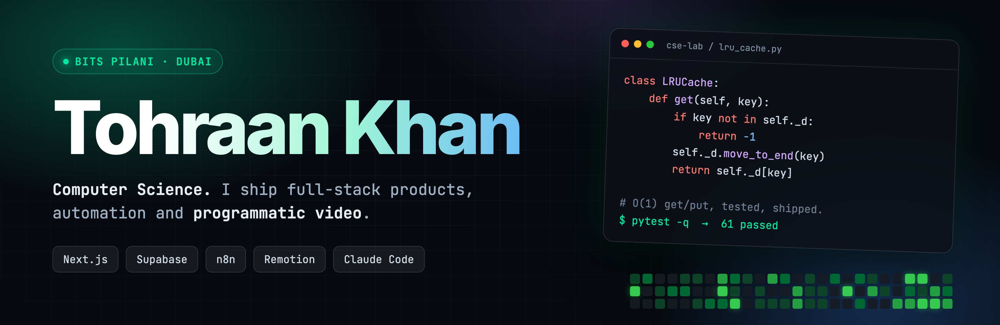
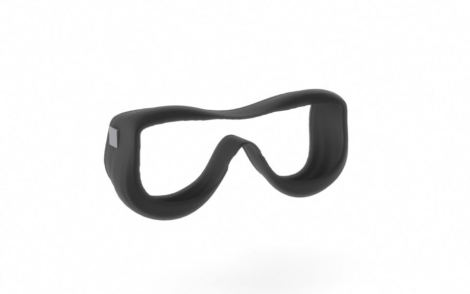
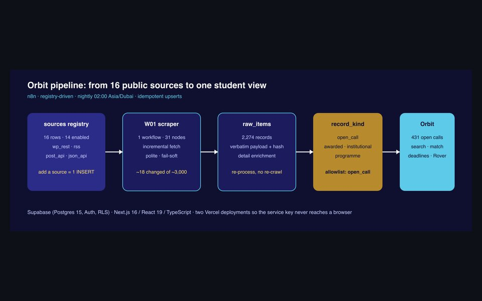
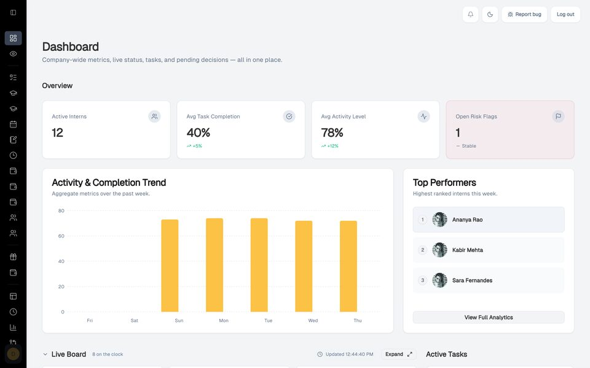
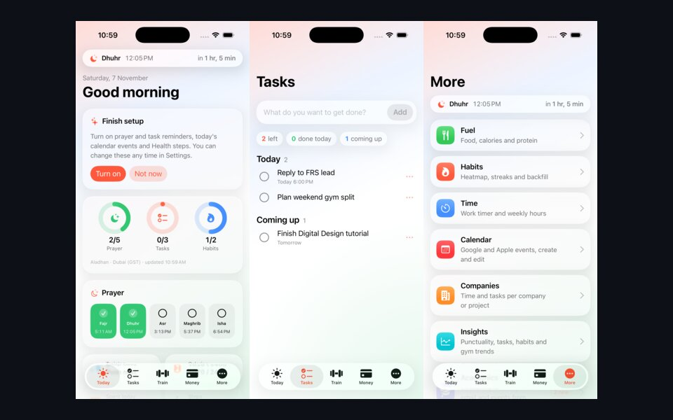
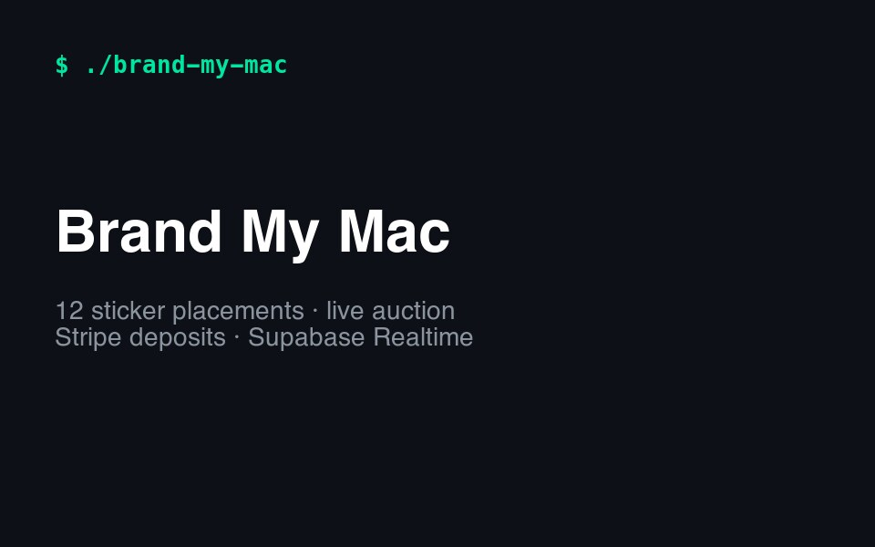
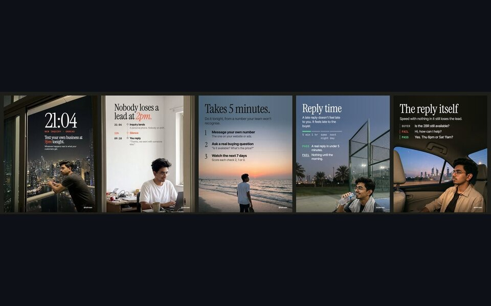
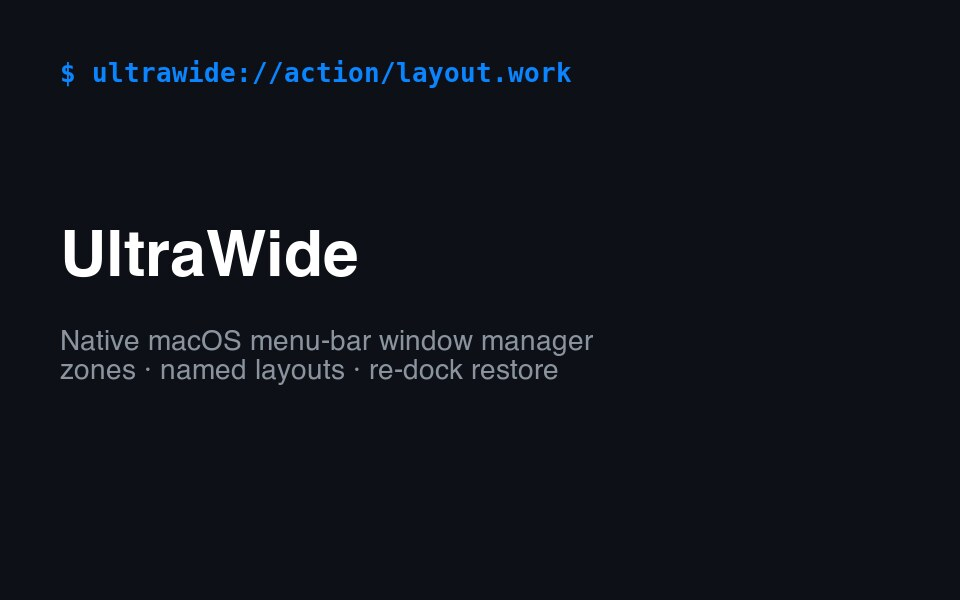
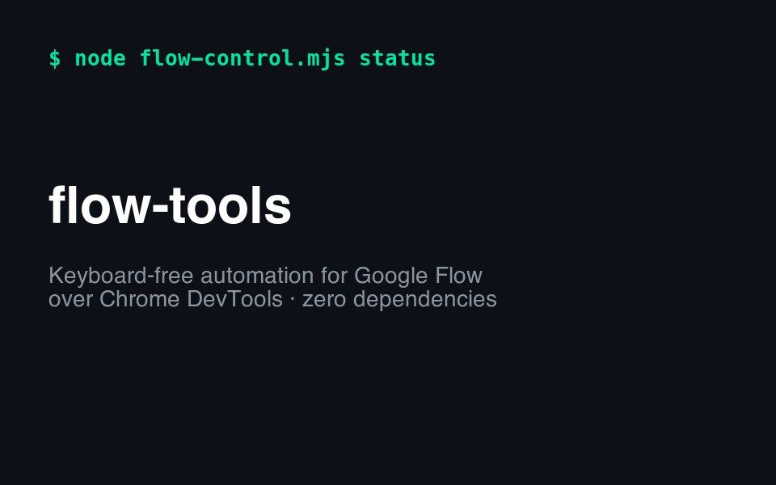

<table>
<tr>
<td valign="top" width="58%">
</td>
<td valign="top" width="42%" align="right">

</td>
</tr>
</table>

### `$ ./contributions.sh`

Want the <b>interactive</b> one? <a href="https://tohraan.github.io/#graph">Hover any day, click it to jump to that day's commits, replay the animation →</a>

How the graph is made

The first commits in <a href="https://github.com/tohraan/cse-lab">cse-lab</a> were backfilled with
<code>tools/build_history.py</code>, so their dates are planned rather than the day the code was first typed.
Every problem in that repo is real, tested code, and a daily workflow now releases new commits with their real dates.
The generator and the grid layout are in that repo's <code>tools/</code> folder.

### `$ whoami`

<table>
  <tr>
    <td valign="top"></td>
    <td valign="top"></td>
  </tr>
</table>

### `$ cat stack.txt`

 

### `$ cat proof.md`

Screenshots are from the real builds. 🔒 marks private repos: ask and I'll walk you through the code.

#### 🏁 Hackathon builds

<table>
<tr>
<td width="50%" valign="top">

 <b>FOCUS</b> &nbsp;🥇 GDG Ideathon · 1st
 Smart study glasses that edit people out of your view. Swift + Metal, 100% on-device.
 <a href="https://github.com/tohraan/focus">repo</a> · launch film + demos in the README
</td>
<td width="50%" valign="top">

 <b>Orbit</b> &nbsp;GDG Ideathon · Ideaverse entry
 Every research opportunity a BITS Pilani Dubai student can apply to, ranked by the deadline that matters next.
 <a href="https://github.com/tohraan/orbit">repo</a> · 86 commits · Next.js 16, Supabase, n8n
</td>
</tr>
<tr>
<td width="50%" valign="top">

 <b>Dalil (دليل)</b> &nbsp;Breaking Bytes · W-001
 Desert water early warning for the GCC: satellites find the water, a model forecasts days left, and villages get a daily voice call.
 <a href="https://dalil-water.vercel.app">live demo</a> · 🔒 private repo
</td>
<td width="50%" valign="top">

 <b>FaceValue</b> &nbsp;HASH IT OUT 2026 · Track 6
 Concert tickets that can't be scalped: verified fans, face-value resale, signed entry passes on Base Sepolia.
 <a href="https://facevalue-psi.vercel.app">live demo</a> · 47 commits · 🔒 private repo
</td>
</tr>
<tr>
<td width="50%" valign="top">

 <b>Fairbook</b> &nbsp;HASH IT OUT 2026
 A sportsbook where the house can't cheat: locked odds, proof of reserves and on-chain disputes.
 Base Sepolia smart contracts · 🔒 private repo
</td>
<td width="50%" valign="top">

 <b>Seas of Data</b> &nbsp;Supernova × SpacePoint 2026
 Finds "dark" ships that switch off AIS, using Sentinel-1 radar. Tracker of 673 real ships.
 <a href="https://github.com/tohraan/seas-of-data">repo</a> · <a href="https://tohraan.github.io/seas-of-data/">site</a> · 4/4 scenes on predicted passes
</td>
</tr>
<tr>
<td width="50%" valign="top">

 <b>AI Voice Heist</b> &nbsp;IEEE stall · 25 Nov 2026
 Talk your way past VAULT, an LLM guard, to win a real snack.
 17 snacks won on the day · 🔒 private repo
</td>
<td width="50%"></td>
</tr>
</table>

#### 🚀 Products I've shipped

<table>
<tr>
<td width="50%" valign="top">

 <b>BITS Bazaar</b> &nbsp;campus marketplace
 The student marketplace for BITS Pilani Dubai. Discovery, trust and the intro, with the deal done over WhatsApp.
 48 Postgres migrations · RLS · 🔒 private repo
</td>
<td width="50%" valign="top">

 <b>Krypsm + Krypsm Ops</b> &nbsp;client platform
 Intern time tracking with no timesheets: Electron agent, React portal, Express API, Chrome extension, plus a separate on-call console.
 4 production surfaces · signed macOS/Windows releases · 35 synthetic probes · 🔒 private repo
</td>
</tr>
<tr>
<td width="50%" valign="top">

 <b>Clearance Desk</b> &nbsp;B2B · UAE logistics
 Mirsal 2 customs declaration prep for Dubai freight forwarders. "Stop paying demurrage for paperwork."
 33 commits · auto-deploys from main · 🔒 private repo
</td>
<td width="50%" valign="top">

 <b>Tempo</b> &nbsp;native app
 SwiftUI life tracker on iPhone, iPad and Mac: prayer, tasks, gym, food, money and work time, with widgets and a Live Activity.
 installed on my iPhone · Supabase sync · 🔒 private repo
</td>
</tr>
<tr>
<td width="50%" valign="top">

 <b>Brand My Mac</b> &nbsp;live auction
 12 sticker spots on a MacBook sold by live auction. Deposits charged and refunded, with idempotent webhooks.
 Stripe + Supabase Realtime · auction paused on purpose · 🔒 private repo
</td>
<td width="50%" valign="top">

 <b>video-os</b> &nbsp;video pipeline
 A talking-head video goes in. Word-timed Remotion captions and agent-planned HyperFrames B-roll come out.
 whisper.cpp → Remotion · 16:9 + 9:16 · 🔒 private repo
</td>
</tr>
<tr>
<td width="50%" valign="top">

 <b>LinkedIn Command Center</b> &nbsp;content OS
 Research → direction → writing → review engine, plus scheduling, analytics and an outreach CRM.
 220 commits · 51 migrations · 🔒 private repo
</td>
<td width="50%" valign="top">

 <b>Tohraan Signal</b> &nbsp;portfolio
 My latest portfolio, cut like a film in six reels: GSAP, Lenis and a three.js shader.
 Next.js 16 · 🔒 private repo
</td>
</tr>
<tr>
<td width="50%" valign="top">

 <b>UltraWide</b> &nbsp;macOS app
 Menu-bar window manager for a 21:9 display: custom zones, named layouts, re-dock restore and media keys.
 ~2,200 lines of Swift · phases 0–7 built · 🔒 private repo
</td>
<td width="50%" valign="top">

 <b>Trading Sensei XR</b> &nbsp;mixed reality
 Gesture-controlled AR/VR trading desk in the browser, with MediaPipe hands and a stress engine.
 <a href="https://github.com/tohraan/trading-sensei">repo</a>
</td>
</tr>
</table>

#### 🧰 Claude Code skills &amp; agent tooling

<table>
<tr>
<td width="50%" valign="top">

 <b>paper-reel</b> &nbsp;Claude Code skill
 Topic → 23-second papercraft stop-motion reel with Pip. Local, $0, and no two reels look alike.
 <a href="https://github.com/tohraan/paper-reel-media">7 reels, watch them</a>
</td>
<td width="50%" valign="top">

 <b>collage-reel</b> &nbsp;Claude Code skill
 Copywriter brief → cut-out zine reel, with scraps landing on the exact spoken word.
 <a href="https://github.com/tohraan/paper-reel-media">watch a reel</a> · 🔒 private repo
</td>
</tr>
<tr>
<td width="50%" valign="top">

 <b>flow-tools</b> &nbsp;agent tooling
 Keyboard-free, zero-dependency automation for Google Flow over the Chrome DevTools Protocol.
 <a href="https://github.com/tohraan/flow-tools">repo</a> · MIT
</td>
<td width="50%"></td>
</tr>
</table>

### `$ ls projects/`

### `$ tail -f activity.log`

<!--START_SECTION:activity-->
1. 🔒 Closed issue [#17](https://github.com/tohraan/pr-lab/issues/17) in [tohraan/pr-lab](https://github.com/tohraan/pr-lab)
2. ❗ Opened issue [#17](https://github.com/tohraan/pr-lab/issues/17) in [tohraan/pr-lab](https://github.com/tohraan/pr-lab)
3. 🎉 Merged PR [#16](https://github.com/tohraan/pr-lab/pull/16) in [tohraan/pr-lab](https://github.com/tohraan/pr-lab)
4. 💪 Opened PR [#16](https://github.com/tohraan/pr-lab/pull/16) in [tohraan/pr-lab](https://github.com/tohraan/pr-lab)
5. 🎉 Merged PR [#15](https://github.com/tohraan/pr-lab/pull/15) in [tohraan/pr-lab](https://github.com/tohraan/pr-lab)
<!--END_SECTION:activity-->

