

<table>
<tr>
<td valign="top" width="58%">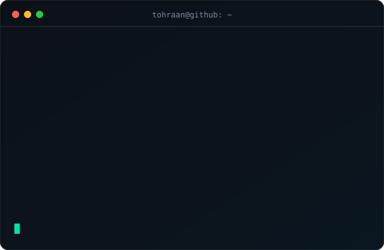
</td>
<td valign="top" width="42%" align="right">

</td>
</tr>
</table>

### `$ ./contributions.sh`

Want the <b>interactive</b> one? <a href="https://tohraan.github.io/#graph">Hover any day, click it to jump to that day's commits, replay the animation →</a>

How the graph is made

The first commits in <a href="https://github.com/tohraan/cse-lab">cse-lab</a> were backfilled with
<code>tools/build_history.py</code>, so their dates are planned rather than the day the code was first typed.
Every problem in that repo is real, tested code, and a daily workflow now releases new commits with their real dates.
The generator and the grid layout are in that repo's <code>tools/</code> folder.

### `$ whoami`

<table>
  <tr>
    <td valign="top"></td>
    <td valign="top"></td>
  </tr>
</table>

### `$ cat stack.txt`

 

### `$ cat proof.md`

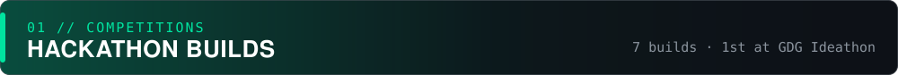

<table>
<tr>
<td width="210" valign="top"></td>
<td valign="top">
<b>FOCUS</b> &nbsp;<code>🥇 GDG Ideathon · 1st</code>
<ul>
<li>Won <b>1st place</b> by building smart study glasses that erase people from your view, using an on-device Swift + Metal compositor with <b>0 cloud calls</b>.</li>
<li>Cut fill error from <b>31.6 to 24.8 (−21%)</b> on a 7-clip benchmark by iterating the inpainting engine.</li>
</ul>
<a href="https://github.com/tohraan/focus">repo</a> · launch film in README
</td>
</tr>
<tr>
<td width="210" valign="top"></td>
<td valign="top">
<b>Orbit</b> &nbsp;<code>GDG Ideathon · Ideaverse</code>
<ul>
<li>Indexed <b>431 open calls</b> from <b>2,274 raw records</b> across <b>14 sources</b> with a nightly n8n → Supabase → Next.js pipeline.</li>
<li>Dropped a source that made up <b>46%</b> of the corpus but targeted the wrong audience, and ranked matches with published weights (degree <b>34%</b>, field <b>26%</b>, funding <b>18%</b>).</li>
</ul>
<a href="https://github.com/tohraan/orbit">repo</a> · 86 commits
</td>
</tr>
<tr>
<td width="210" valign="top"><a href="https://dalil-water.vercel.app">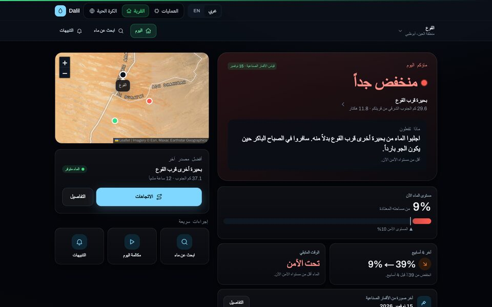</a></td>
<td valign="top">
<b>Dalil (دليل)</b> &nbsp;<code>Breaking Bytes · W-001</code>
<ul>
<li>Caught <b>92%</b> of desert water-source dry-ups (<b>77</b> backtest events, <b>9-week</b> median warning) by forecasting satellite water history, with <b>18%</b> less error than a no-change baseline.</li>
<li>Reached villages without smartphones through a bilingual EN/AR Twilio voice call that tells them the days left and the nearest source.</li>
</ul>
<a href="https://dalil-water.vercel.app">live demo</a> · 🔒 private
</td>
</tr>
<tr>
<td width="210" valign="top"><a href="https://facevalue-psi.vercel.app">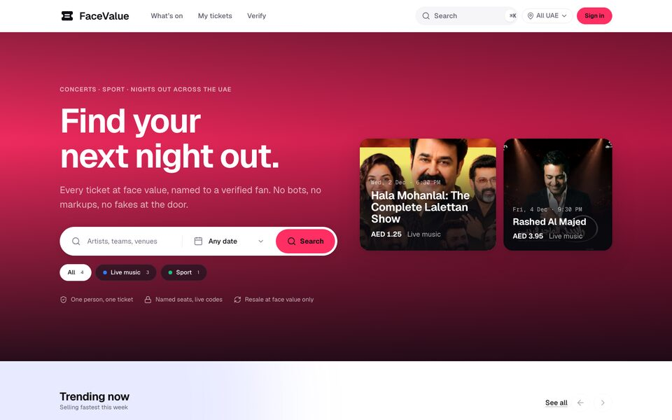</a></td>
<td valign="top">
<b>FaceValue</b> &nbsp;<code>HASH IT OUT 2026 · Track 6</code>
<ul>
<li>Made ticket scalping impossible by putting <b>1 ticket per person</b>, face-value-only resale (<b>95%</b> to the seller, <b>5%</b> to the organiser) and <b>5-minute</b> single-use entry passes into a Base Sepolia smart contract.</li>
</ul>
<a href="https://facevalue-psi.vercel.app">live demo</a> · 47 commits · 🔒 private
</td>
</tr>
<tr>
<td width="210" valign="top"><a href="https://fairbook-gray.vercel.app">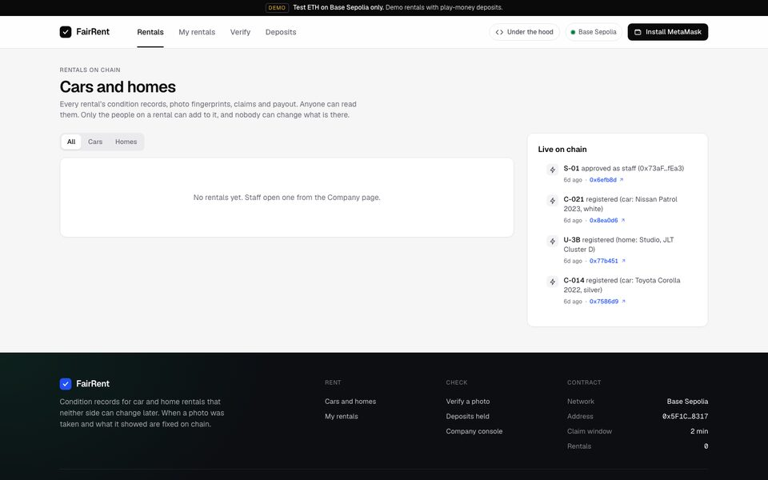</a></td>
<td valign="top">
<b>FairRent</b> &nbsp;<code>HASH IT OUT 2026</code>
<ul>
<li>Ended rental-deposit disputes by having renters co-sign photo-fingerprinted condition records in a Solidity contract on Base Sepolia, so no one can rewrite them later.</li>
<li>Covered the contract with <b>11 passing tests</b>, and the live demo shows <b>10 of 10</b> cheat attempts being refused.</li>
</ul>
<a href="https://fairbook-gray.vercel.app">live demo</a> · 🔒 private
</td>
</tr>
<tr>
<td width="210" valign="top"><a href="https://github.com/tohraan/seas-of-data">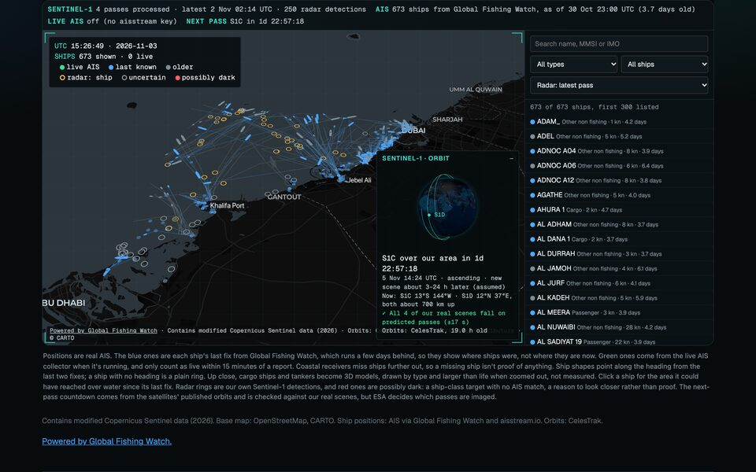</a></td>
<td valign="top">
<b>Seas of Data</b> &nbsp;<code>Supernova × SpacePoint 2026</code>
<ul>
<li>Flagged <b>16</b> possibly-dark ships by detecting <b>250</b> vessels on Sentinel-1 radar at <b>94%</b> ship precision and cross-checking them against Global Fishing Watch AIS.</li>
<li>Matched <b>4 of 4</b> scenes to predicted satellite passes (±17 s) on a live tracker of <b>673</b> ships.</li>
</ul>
<a href="https://github.com/tohraan/seas-of-data">repo</a> · <a href="https://tohraan.github.io/seas-of-data/">site</a>
</td>
</tr>
<tr>
<td width="210" valign="top"></td>
<td valign="top">
<b>AI Voice Heist</b> &nbsp;<code>IEEE stall · 25 Nov 2026</code>
<ul>
<li>Ran a live LLM social-engineering game for <b>84 players</b> across <b>92 plays</b>, with <b>17</b> snacks won.</li>
<li>Lifted the win rate from <b>2% to 43%</b> with a mid-event difficulty patch.</li>
</ul>
🔒 private
</td>
</tr>
</table>

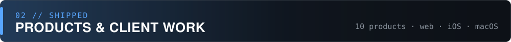

<table>
<tr>
<td width="210" valign="top">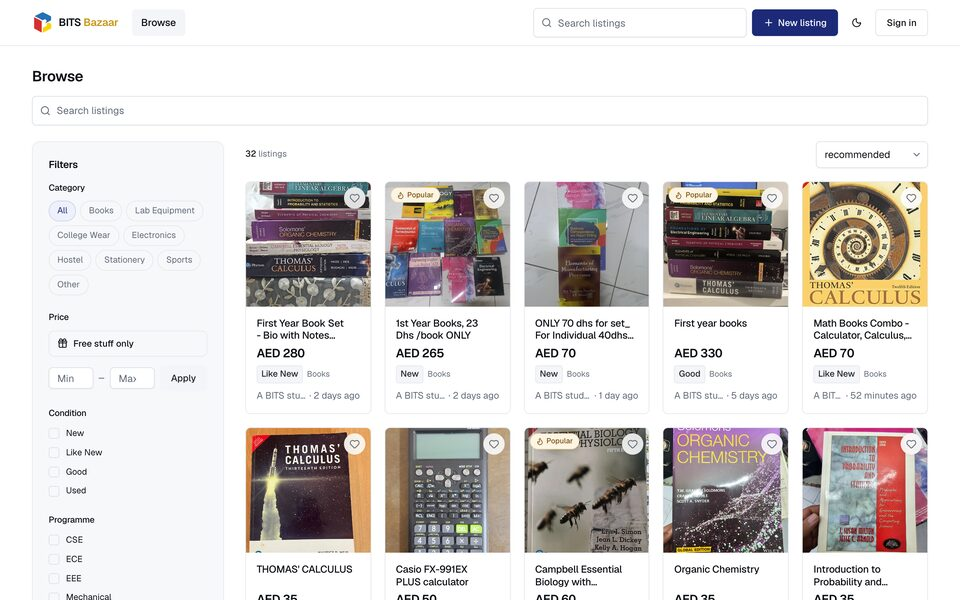</td>
<td valign="top">
<b>BITS Bazaar</b> &nbsp;<code>campus marketplace</code>
<ul>
<li>Launched the BITS Pilani Dubai student marketplace on Next.js 16 + Supabase, reaching <b>36 live listings from 11 students</b> (checked 17 Oct 2026).</li>
<li>Fixed a seller stat that showed <b>4 messages</b> for a listing with <b>1</b> by deriving taps vs. real messages in SQL. <b>48</b> migrations with row-level security.</li>
</ul>
🔒 private
</td>
</tr>
<tr>
<td width="210" valign="top"></td>
<td valign="top">
<b>Krypsm + Krypsm Ops</b> &nbsp;<code>client platform</code>
<ul>
<li>Replaced manual intern timesheets with <b>4 surfaces</b> (Electron agent, React portal, Express API, Chrome MV3 extension) serving <b>5 roles</b>.</li>
<li>Wrote <b>205 checks</b> across 7 roles, whose first run caught <b>6 real bugs</b>, and built an on-call console that probes <b>35</b> routes every <b>10 min</b>.</li>
</ul>
signed macOS + Windows installers · 🔒 private
</td>
</tr>
<tr>
<td width="210" valign="top">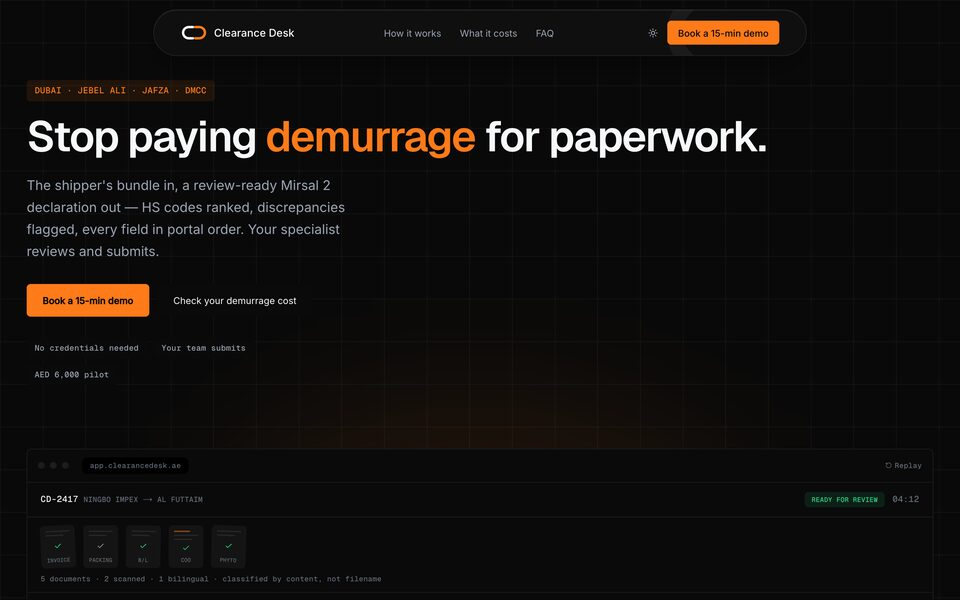</td>
<td valign="top">
<b>Clearance Desk</b> &nbsp;<code>B2B · UAE logistics</code>
<ul>
<li>Automated <b>4 of the 6</b> steps in Dubai Mirsal 2 customs prep (classify, extract, cross-check, rank HS codes), so a forwarder only reviews the declaration.</li>
<li>Shipped the landing page, demurrage calculator, VSL and lead capture in <b>33 commits over 2 days</b>.</li>
</ul>
🔒 private
</td>
</tr>
<tr>
<td width="210" valign="top"></td>
<td valign="top">
<b>Tempo</b> &nbsp;<code>SwiftUI · iOS + macOS</code>
<ul>
<li>Rebuilt a lost life-tracker as <b>one SwiftUI codebase on 3 platforms</b> (iPhone, iPad, Mac) with <b>11 modules</b>, widgets and a Live Activity.</li>
<li>Shared logic is covered by <b>34 tests</b> in TempoKit, with Supabase sync kept alive by a daily CI ping.</li>
</ul>
installed on my iPhone · 🔒 private
</td>
</tr>
<tr>
<td width="210" valign="top"></td>
<td valign="top">
<b>Brand My Mac</b> &nbsp;<code>live auction</code>
<ul>
<li>Auctioned <b>12</b> sticker spots on a real MacBook with Stripe + Supabase Realtime, charging max(<b>20%</b>, <b>$10</b>) deposits up front because card holds expire in about <b>7 days</b>.</li>
<li>Made double refunds impossible with <b>3 independent guards</b> and idempotent Stripe webhooks.</li>
</ul>
auction paused on purpose · 🔒 private
</td>
</tr>
<tr>
<td width="210" valign="top">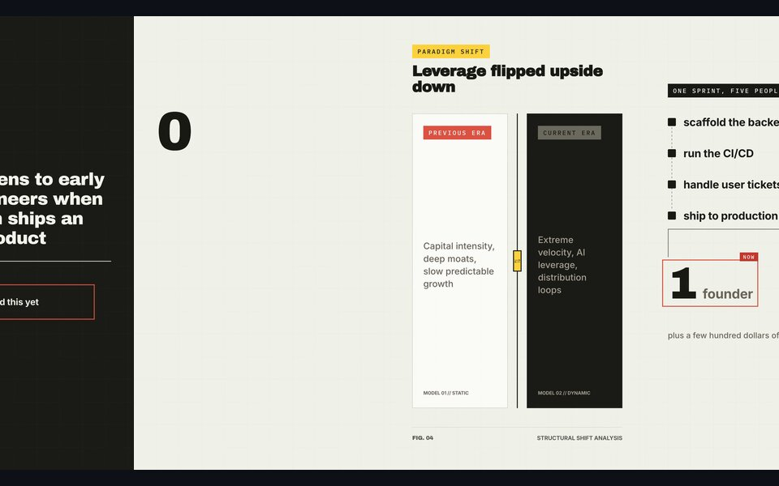</td>
<td valign="top">
<b>video-os</b> &nbsp;<code>video pipeline</code>
<ul>
<li>Automated talking-head captions with ffmpeg → whisper.cpp word timings → Remotion, sizing the captions from the speaker's measured face height.</li>
<li>Rendered agent-planned B-roll cutaways in HyperFrames in <b>2 ratios</b> (16:9 + 9:16), each with a cut list.</li>
</ul>
🔒 private
</td>
</tr>
<tr>
<td width="210" valign="top"></td>
<td valign="top">
<b>LinkedIn Command Center</b> &nbsp;<code>content OS</code>
<ul>
<li>Built a content engine for <b>4 channels</b> that runs research → direction → writing → review as leased, retryable jobs: <b>220 commits</b>, <b>51 migrations</b>.</li>
<li>Tracks outreach with a <b>7-step</b> follow-up CRM and an auto-generated weekly funnel review.</li>
</ul>
🔒 private
</td>
</tr>
<tr>
<td width="210" valign="top">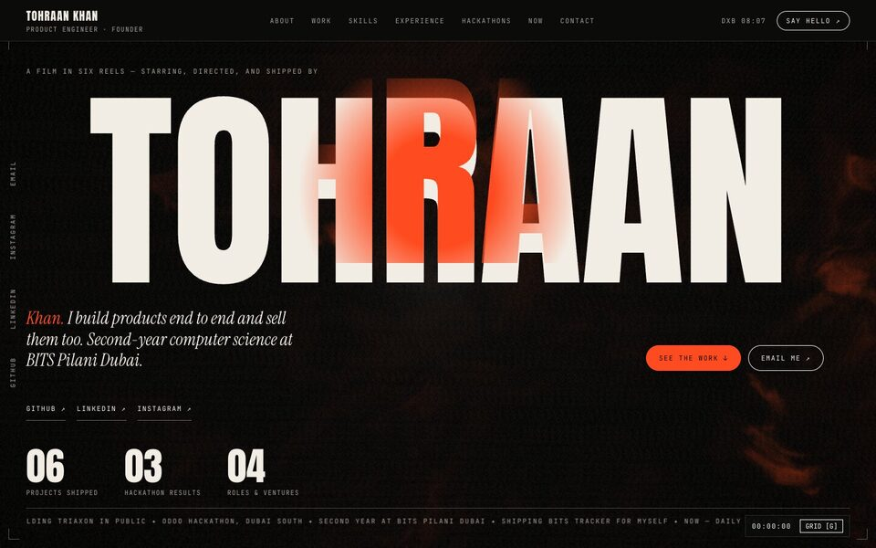</td>
<td valign="top">
<b>Tohraan Signal</b> &nbsp;<code>portfolio</code>
<ul>
<li>Designed my portfolio as a film in <b>6 reels</b> with GSAP, Lenis and a three.js shader, with every claim sourced from <b>1</b> data file.</li>
</ul>
Next.js 16 · 🔒 private
</td>
</tr>
<tr>
<td width="210" valign="top"></td>
<td valign="top">
<b>UltraWide</b> &nbsp;<code>native macOS</code>
<ul>
<li>Filled <b>4 gaps</b> no open-source window manager covers (custom zones, app layouts, named layouts, re-dock restore) in <b>~2,200 lines</b> of Swift, with <b>0 private APIs</b> and <b>40+</b> geometry tests.</li>
</ul>
🔒 private
</td>
</tr>
<tr>
<td width="210" valign="top"><a href="https://github.com/tohraan/trading-sensei">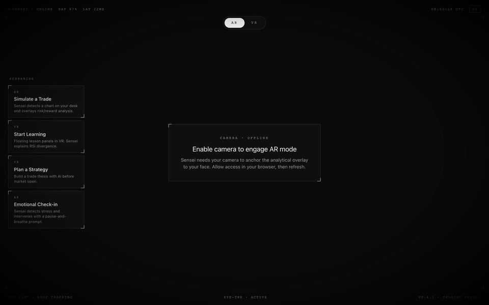</a></td>
<td valign="top">
<b>Trading Sensei XR</b> &nbsp;<code>mixed reality</code>
<ul>
<li>Turned a webcam into a gesture-controlled AR/VR trading desk with MediaPipe hand tracking at <b>30 fps</b> and a face-api stress engine that steps in on tilt.</li>
</ul>
<a href="https://github.com/tohraan/trading-sensei">repo</a>
</td>
</tr>
</table>

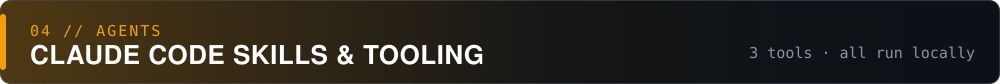

<table>
<tr>
<td width="210" valign="top"><a href="https://github.com/tohraan/paper-reel-media">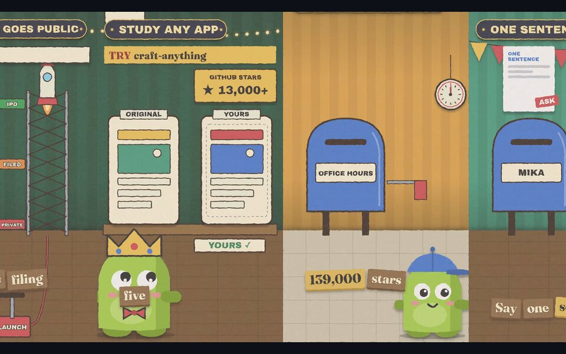</a></td>
<td valign="top">
<b>paper-reel</b> &nbsp;<code>Claude Code skill</code>
<ul>
<li>Published <b>7</b> papercraft stop-motion reels (~<b>23 s</b>, <b>6</b> beats each) for <b>$0</b> with a local HyperFrames + Kokoro + whisper pipeline.</li>
<li>Keeps every reel different by picking the least-used option on <b>10</b> style axes.</li>
</ul>
<a href="https://github.com/tohraan/paper-reel-media">watch the reels</a> · engine 🔒 private
</td>
</tr>
<tr>
<td width="210" valign="top"><a href="https://github.com/tohraan/paper-reel-media">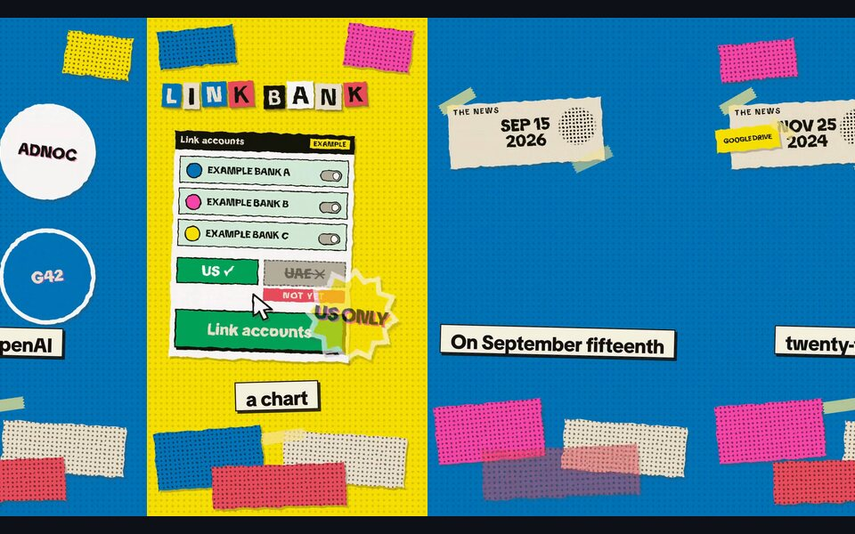</a></td>
<td valign="top">
<b>collage-reel</b> &nbsp;<code>Claude Code skill</code>
<ul>
<li>Turns a copywriter's brief into a cut-out zine reel using <b>9</b> layout kits, with every scrap landing on its spoken word. <b>5</b> reels rendered locally for <b>$0</b>.</li>
</ul>
<a href="https://github.com/tohraan/paper-reel-media">watch a reel</a> · 🔒 private
</td>
</tr>
<tr>
<td width="210" valign="top"></td>
<td valign="top">
<b>flow-tools</b> &nbsp;<code>agent tooling</code>
<ul>
<li>Automated Google Flow generation and <b>1K/2K/4K</b> downloads over the raw Chrome DevTools Protocol with <b>0 dependencies</b>. It runs as a LaunchAgent that survives sleep/wake.</li>
</ul>
<a href="https://github.com/tohraan/flow-tools">repo</a> · MIT
</td>
</tr>
</table>

Every number comes from the repo, its README or a dated check. 🔒 = private repo, happy to walk through the code.

### `$ ls projects/`

### `$ tail -f activity.log`

<!--START_SECTION:activity-->
1. 🔒 Closed issue [#17](https://github.com/tohraan/pr-lab/issues/17) in [tohraan/pr-lab](https://github.com/tohraan/pr-lab)
2. ❗ Opened issue [#17](https://github.com/tohraan/pr-lab/issues/17) in [tohraan/pr-lab](https://github.com/tohraan/pr-lab)
3. 🎉 Merged PR [#16](https://github.com/tohraan/pr-lab/pull/16) in [tohraan/pr-lab](https://github.com/tohraan/pr-lab)
4. 💪 Opened PR [#16](https://github.com/tohraan/pr-lab/pull/16) in [tohraan/pr-lab](https://github.com/tohraan/pr-lab)
5. 🎉 Merged PR [#15](https://github.com/tohraan/pr-lab/pull/15) in [tohraan/pr-lab](https://github.com/tohraan/pr-lab)
<!--END_SECTION:activity-->

